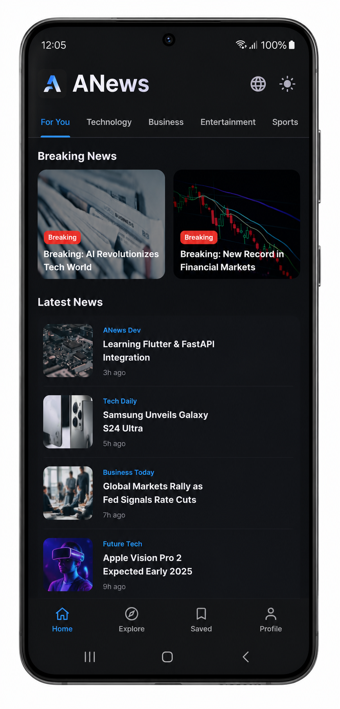
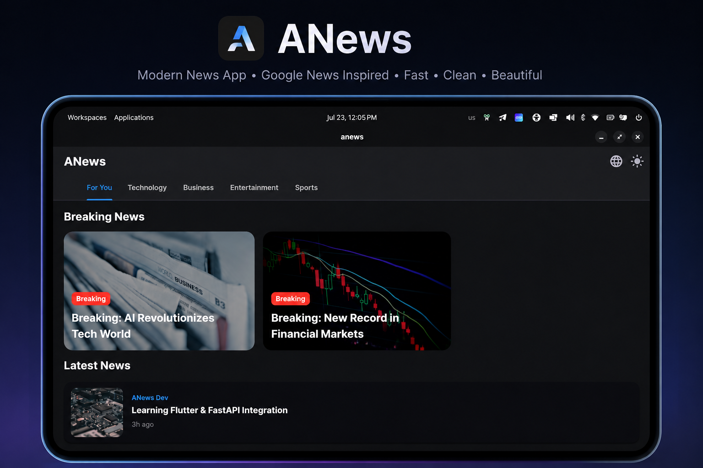

<p align="center">
  
</p>

<h1 align="center">ANews</h1>

<p align="center">
  <b>A bilingual (English / Farsi) news app — a FastAPI news backend with Flutter and Kotlin Multiplatform clients.</b>
</p>

<p align="center">
  <a href="https://aghorbani84.github.io/Anews/"></a>
  
  
  
  
  
</p>

---

> [!WARNING]
> **The Flutter app's Dart source (`anews/lib/`) is not in this repository.** The `anews/` folder contains the Flutter project scaffolding (platform folders, `pubspec.yaml`, icons), but `flutter run` will not work until `lib/main.dart` and the rest of the client code are committed. The FastAPI backend and the Kotlin Multiplatform module are present.

## Overview

ANews fetches real headlines and splits them into **breaking** and **latest** news, in English or Farsi. The repository holds three parts:

| Part | Path | State |
| --- | --- | --- |
| News API backend | `backend/` | ✅ Present — FastAPI service backed by the Webz.io News API Lite |
| Flutter client | `anews/` | ⚠️ Scaffolding only — Dart source missing |
| Kotlin Multiplatform client | `anews/kotlinMultiplatform/` | 🧪 Experimental — Android + iOS targets, Compose UI, uses NewsAPI.org |
| Project landing page | `docs/` | ✅ Published on [GitHub Pages](https://aghorbani84.github.io/Anews/) |

## Features

**Backend (`backend/main.py`)**

- `GET /api/news?lang=en|fa` returns `{ breaking_news, latest_news }`
- Queries Webz.io for English or Farsi articles and normalizes each to `id`, `title`, `description`, `image_url`, `source`, `published_at`
- API key loaded from `.env` (`WEBZ_API_KEY`) — never hard-coded
- Clear error responses for a missing key (500) or upstream connection failures (503), with a 15-second timeout

**Kotlin Multiplatform module**

- Shared Ktor client and Kotlinx Serialization models
- Top headlines (by country and optional category) and search against NewsAPI.org
- A Compose `NewsScreen` with loading and error states, used by the Android app

## Tech Stack

- **Backend:** Python, FastAPI, Uvicorn, HTTPX, Pydantic, python-dotenv
- **Flutter client:** Flutter / Dart (`http` package)
- **KMP client:** Kotlin 2.0, Ktor 3, Kotlinx Serialization, Jetpack Compose (Material 3), Gradle
- **News sources:** [Webz.io News API Lite](https://webz.io/products/news-api#lite) (backend), [NewsAPI.org](https://newsapi.org/) (KMP client)

## Getting Started

### Run the backend

You need Python 3.9+ and a free Webz.io API token.

```bash
git clone https://github.com/aghorbani84/Anews.git
cd Anews/backend

python -m venv venv
source venv/bin/activate          # Windows: venv\Scripts\activate
pip install -r requirements.txt

cp .env.example .env              # then set WEBZ_API_KEY in .env
python main.py                    # serves on http://0.0.0.0:8000
```

Try it:

```bash
curl "http://localhost:8000/api/news?lang=en"
```

Interactive API docs are served by FastAPI at http://localhost:8000/docs.

### Build the Kotlin Multiplatform Android app

```bash
cd anews/kotlinMultiplatform
# set your NewsAPI.org key in androidApp/src/main/java/com/example/anews/MainActivity.kt
./gradlew :androidApp:assembleDebug
```

### Flutter client

Once the Dart source is added under `anews/lib/`:

```bash
cd anews
flutter pub get
flutter run
```

On an Android emulator the backend is reachable at `10.0.2.2:8000`; on a physical device use your computer's LAN IP.

## Screenshots

<table align="center">
  <tr>
    <td align="center"><br /><sub>Mobile (dark mode)</sub></td>
    <td align="center"><br /><sub>Linux desktop (dark mode)</sub></td>
  </tr>
</table>

<sub>Screenshots of the Flutter client, whose source is not yet committed.</sub>

## Project Structure

```text
Anews/
├── backend/                 # FastAPI news service
│   ├── main.py
│   ├── requirements.txt
│   └── .env.example
├── anews/                   # Flutter project (platform folders, pubspec)
│   └── kotlinMultiplatform/ # KMP module: shared/ + androidApp/
├── docs/                    # GitHub Pages landing page
└── Assets/                  # Logo and screenshots
```

## License

No license file has been added yet, so all rights are reserved by default.

## Author

Built by [@aghorbani84](https://github.com/aghorbani84).
